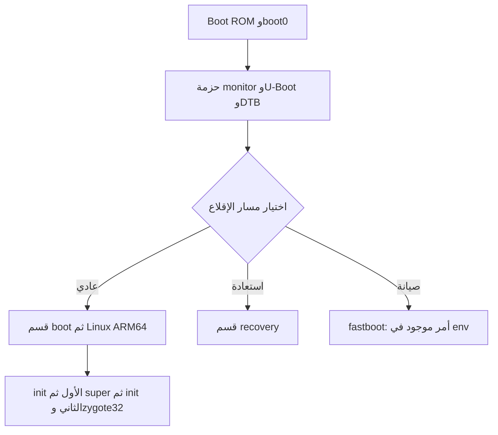

# تحليل إقلاع H20 Pro من النسخة الأصلية

فُحصت صورة eMMC التي رفعها المستخدم كاملة للتحقق من بصمتها، ثم حُلّلت مكونات
الإقلاع والأقسام المنطقية وملفات بدء تشغيل النظام دون توصيل الجهاز أو الكتابة عليه.
هذا تحليل للملفات؛ ليس تسجيلاً لإقلاع فعلي، ولا يثبت جاهزية نسخة Android جديدة.

## مصدر الدليل
- الملف المضغوط:1493189716 بايت؛ SHA256:
  `4e25a18c945f3d28445cb48875ae567715f72a05e5ab3aef9048aff76953c456`.
- الصورة المفكوكة:7818182656 بايت؛ SHA256:
  `dd2db326486d188f94f4de1a7710049377ab645f122ee3bffc2ade7f442db293`.
- أُعيد التحقق من البصمتين أثناء هذا التحليل. طابقتا التقرير السابق.
- استُخرجت boot وrecovery وenv وvbmeta وsystem وvendor وproduct محلياً.
  اجتازت نسخ metadata الأربع داخل super فحوص SHA256 وحدود الامتدادات.
- يحتوي STOCK_BOOT_CHAIN_AUDIT.json على القيم والبصمات ومصادر ملفات الخدمات.

## خريطة الإقلاع المستنتجة من مكونات الصورة

الأسهم تصف المسار المتوقع من البنية والأوامر؛ لم يُراقَب اختيار Boot ROM للنسخة
أو انتقالات المعالج عبر UART في هذه الجلسة.

## مراحل الإقلاع الموجودة فعلياً
| المكوّن | الموضع/الدليل | النتيجة |
|---|---|---|
| boot0 | إزاحتان8192 و262144 بايت | نسختان متطابقتان، كل منهما65536 بايت؛ المجموع الاختباري صحيح |
| sunxi-package | إزاحتان12582912 و16793600 | نسختان متطابقتان، طول كل منهما1294336 بايت؛ المجموع الاختباري صحيح |
| مكونات الحزمة | u-boot، monitor، dtbo، dtb | فُحصت الحدود والبصمات؛ جميعها موسومة encrypted=0 في الجدول |
| U-Boot | سلسلة الإصدار داخل الملف التنفيذي | 2018.05، بناء2024-04-09 |
| monitor | سلاسل الإصدار داخل المكوّن | v1.0(debug):25d6c57، بناء2021-01-20 |
| env | أول128KiB من قسم env | CRC32 صحيح:95972bf5 |

القسم المسمّى bootloader يبدأ عند36MiB؛ العثور على مراحل الإقلاع في المنطقة
المحجوزة قبله مهم. نسخ الأقسام المسماة وحدها لا تمثل بالضرورة كل سلسلة الإقلاع.
هذه الصورة لمنطقة المستخدم في eMMC؛ لا تحتوي المنطقتين العتاديتين boot0/boot1
أو RPMB. اسم ملف boot0 المستخرج هنا لا يعني أنه نسخة من المنطقة العتادية boot0.

## أوامر U-Boot المحفوظة
الإقلاع العادي، كما هو مخزّن في env:
```text
boot_normal=sunxi_flash read 45000000 boot;bootm 45000000
boot_recovery=sunxi_flash read 45000000 recovery;bootm 45000000
boot_fastboot=fastboot
bootcmd=run setargs_nand boot_normal
bootdelay=0
console=ttyS0,115200
```
هذه أدلة مقتبسة من الصورة، وليست أوامر مطلوباً تنفيذها على الجهاز.
وجود اسم setargs_nand لا يحدد وسيط التخزين الفعلي: توجد أيضاً setargs_mmc وmmc_root.
قد تعدّل الشيفرة متغيرات البيئة وقت التشغيل؛ لا نملك تتبعاً لهذه التعديلات.

## صورة boot وتهيئة أندرويد
- قسم boot سعته32MiB، وترويسة أندرويد v2 بحجم صفحة2048 بايت.
- عنوان قراءة الصورة المرحلي في env هو0x45000000. عنوان النواة داخل الترويسة
  0x40080000، والرامديسك0x43000000، وDTB عند0x44000000.
- النواة18806792 بايت، والرامديسك771329 بايت بصيغة gzip، وDTB حجمه137860 بايت.
- استُخرج إعداد النواة IKCONFIG: ARM64 وCOMPAT وMODVERSIONS مفعّلة، وinit=/init.
- init داخل الرامديسك ملف ARM32 بلا مفسّر برامج، بينما init الثاني ARM32 ويستخدم
  `/system/bin/bootstrap/linker`. رابط init في جذر system يشير إلى `/system/bin/init`.
- fstab الأول يركّب system/vendor/product كأقسام ext4 منطقية مع first_stage_mount.
- قسم UDISK مستخدم لـ/data بصيغة f2fs؛ cache وmetadata بصيغة ext4.
- ملف init.sun50iw9p1.rc يحمّل إعدادات الجهاز وUSB، ويستدعي mount_all، ثم يحمّل
  mali_kbase.ko في late-fs. ملف init.zygote32.rc يشغّل app_process وSystemServer.

## معلومات جديدة مفيدة للنقل
**USB0:** الخاصية `persist.vendor.usb0device` موصولة مباشرة بملف init:
القيمة1 تجعل init يقرأ `/sys/devices/platform/soc/usbc0/usb_device`، والقيمة0
تجعله يقرأ `usb_host`. وحدة UDC هي `5100000.udc-controller`.
يجب نقل هذا السلوك مع تعريف USB المناسب، لا الاكتفاء بنقل DTB الذي يعلن وضع Host.

**الريموت:** ملف `/system/etc/init/multi_ir.rc` يطلق `/system/bin/multi_ir`
كخدمة main، بمستخدم root ومجموعات system/input/uhid. الخدمة تستخدم /dev/input
و/dev/uinput وتعتمد على libmultiirservice؛ ليست خريطة أزرار وحدها.

**Wi-Fi:** خدمة wl_info تشغّل wireless_hwinfo للتعرّف على الوحدة. الوحدة الأصلية
SSV6x5x تحمل alias3030:3030 ومعاملَي stacfgpath وcfgfirmwarepath. تحتوي الشيفرة
الثنائية عائلات6006A/C/D؛ وجود أسمائها لا يحدد وحده الشريحة المركّبة فعلياً.

**Mali:** إصدار وحدة النواة r20p0-01rel0، وبروتوكول UK11.17. تطابق إصدار النواة
ومكتبات الرسوميات مهم؛ مكتبة عشوائية من جهاز آخر ليست بديلاً مثبتاً.

**UART:** بيانات boot0 وDTB تتفق على UART0 والوظيفتين PH0/PH1، والبيئة تضبط
115200. لا تحدد الصورة وحدها موضع نقاط اللحام أو جهدها على اللوحة.

**RAM:** السجل الأول داخل boot0 يحمل clock=792 وtype=7؛ توجد سجلات بديلة.
العقدة /dram في DTB تحمل600 وtype=3. لذلك لا يجوز اختيار إعداد الذاكرة اعتماداً
على عقدة DTB وحدها أو افتراض أي سجل استُخدم فعلياً دون دليل وقت التشغيل.

## التوقيع وما لا تثبته الصورة
ملف vbmeta يعلن SHA256_RSA4096 وFlags=0، ويربط vbmeta_system وvbmeta_vendor.
يحتوي بصمتَي boot وrecovery وهاشتري product. أُعيد التحقق من السلسلة في هذه الجولة:
اجتازت تواقيع vbmeta والجداول التابعة وفحوص boot وrecovery وsystem وvendor وproduct،
وتطابقت مفاتيح الأقسام التابعة مع أوصاف السلسلة. استُخدمت المفاتيح المضمّنة. هذا يثبت اتساق الملفات، لا حالة eFuse/RPMB أو قبول
محمّل الجهاز لأي مفتاح جديد. تغيير boot أو الأقسام يتطلب معالجة توقيع متسقة.

## النتيجة العملية
أصبحت طريقة التجميع الأصلية ومسارات init وUSB والريموت أوضح من ملفات الجهاز نفسها.
لا نحتاج إعادة رفع الصورة أو أوامر ADB للحصول على هذه المعلومات الموجودة داخلها.
لكن تحليل الصورة لا يحوّل تعريفات4.9 أو vendor29 تلقائياً إلى Android12 أو16،
ولا يثبت إقلاع صورة جديدة. يلزم تكييف النواة والتعريفات والرامديسك والتوقيع، ثم
اختبار إقلاع مضبوط على الجهاز. لم تُنتج هنا صورة فيرموير جديدة.

مراجع بنية الحزمة المستخدمة للمقارنة:
- BPI-SINOVOIP/BPI-H618-Android12 @250eabfc529518b7f26432663ed0a867ab2f625d:
  include/private_toc.h وinclude/private_boot0.h تحت longan/brandy/brandy-2.0/u-boot-2018.
- [AOSP avbtool](https://android.googlesource.com/platform/external/avb/+/refs/heads/main/avbtool.py): تحليل معلومات vbmeta والتحقق من التواقيع والهاشتري.
- [بنية حزمة الإقلاع](https://github.com/BPI-SINOVOIP/BPI-H618-Android12/blob/250eabfc529518b7f26432663ed0a867ab2f625d/longan/brandy/brandy-2.0/u-boot-2018/include/private_toc.h).
- [بنية boot0](https://github.com/BPI-SINOVOIP/BPI-H618-Android12/blob/250eabfc529518b7f26432663ed0a867ab2f625d/longan/brandy/brandy-2.0/u-boot-2018/include/private_boot0.h).
